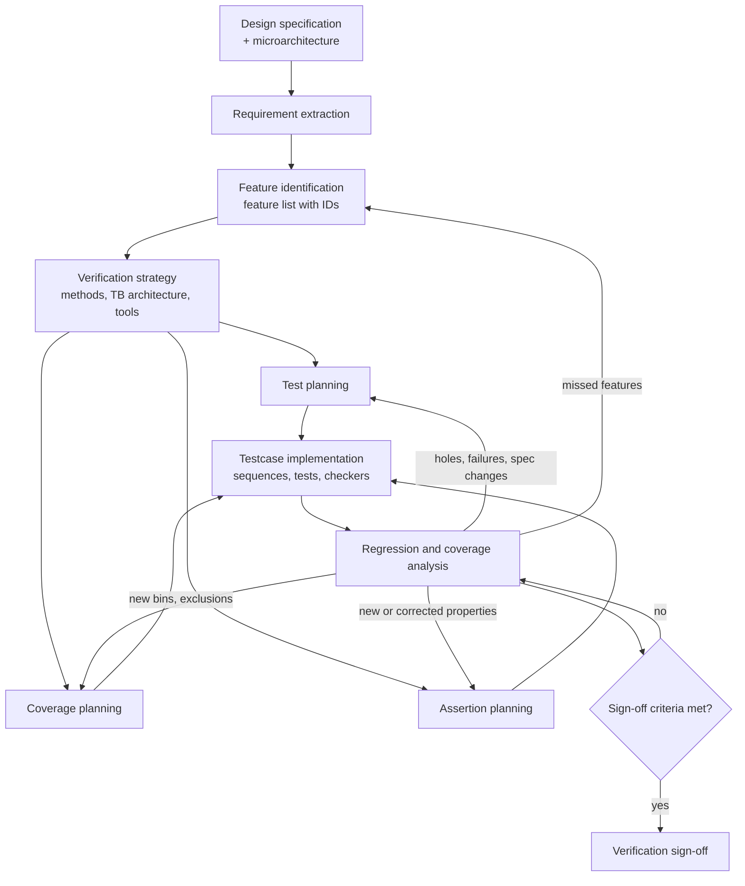

# Verification Plan

*From design requirements to measurable verification completeness.*

DV Lexicon › Verification Fundamentals › Verification Plan

| | |
|---|---|
| **Category** | Verification Fundamentals |
| **Subcategory** | Verification Methodology & Planning |
| **Difficulty** | Intermediate |
| **Estimated reading time** | 28 min |
| **Tags** | `verification-plan`, `test-plan`, `coverage-plan`, `assertion-plan`, `traceability`, `sign-off`, `uvm`, `sva`, `fifo` |
| **Related vocabulary** | Feature List, Test Plan, Coverage Plan, Assertion Plan, Testcase Description, Requirements Traceability, Verification Strategy, Verification Sign-off |

> **Definition.** A verification plan is the engineering agreement on what must be verified, how each item will be verified, and what evidence proves it is done.


## On this page

1. Quick definition
2. The six core concepts
3. Verification planning workflow
4. Practical example: synchronous FIFO
5. Coverage plan example
6. Assertion plan example
7. Detailed testcase: TC_FIFO_OVERFLOW_001
8. Debugging scenario: the overflow bin that never got hit
9. Interview preparation
10. Knowledge check
11. Related vocabulary and further reading

---

## 01 — Quick definition

A **verification plan** is the document (or database) that turns a design specification into a verifiable list of features, decides **how** each feature will be verified (simulation, assertions, formal, emulation, GLS), and defines the **measurable evidence** that says each feature is done. It is owned by verification, reviewed with design and architecture, and kept alive for the whole project.

**Why it's necessary.** Without a plan, "done" means "the regression is green". A green regression only tells you that the checks you wrote did not fail on the stimulus you generated. The plan is what tells you whether those checks and that stimulus actually covered what the specification requires.

**How it differs from a test plan.** The test plan is one part of the verification plan. It lists the tests and scenarios. The verification plan also covers the strategy, the coverage model, the assertion plan, the checking architecture, tools, resources, risks and sign-off criteria.

**What goes wrong when planning is incomplete.**

- Features nobody listed are never verified, and nothing in the regression reports the gap.
- Coverage is written against what the testbench happens to do, not what the spec requires, so it reaches 100% while real corners stay untested.
- Checkers are missing for some features, so tests "pass" because nothing looked.
- Sign-off turns into a negotiation late in the project instead of a measurement.

**How it shapes architecture and sign-off.** The plan decides early which features need a reference model, which need assertions, which are better proven formally, and which configurations must be built. Those decisions set the shape of the testbench. At the end, the same plan provides the checklist that sign-off is measured against.

> [!IMPORTANT]
> **Key takeaway.** A verification plan defines *what "verified" means* for this design, before anyone writes a test. Regressions, coverage and assertions are evidence. The plan is what that evidence is measured against.

---

## 02 — The six core concepts

### 2.1 Verification Plan

| | |
|---|---|
| **Technical definition** | The top-level verification document: features, verification methods, checking strategy, coverage and assertion models, test list, environment architecture, schedule, risks and sign-off criteria. |
| **Purpose** | Agree on scope and completeness criteria before implementation, then track progress against them. |
| **Inputs** | Design specification, microarchitecture document, interface protocols, register map, integration and use-case requirements, previous-project lessons. |
| **Deliverable** | A reviewed plan (document or vPlan/spreadsheet database) linked to coverage and test results, with a sign-off checklist. |
| **Real-world use** | Reviewed at kickoff with design and architecture, re-reviewed at each milestone, and used as the agenda for the final sign-off review. |
| **Common mistakes** | Written once and never updated; copied from a previous project; lists tests instead of features; no measurable exit criteria. |
| **Relationships** | Parent of the feature list, test plan, coverage plan and assertion plan. Holds the verification strategy and sign-off criteria. |

**Interview question:** Who owns the verification plan, and who must review it?

**Answer:** Verification owns and maintains it. Design and architecture must review it, because they are the only people who can say whether the feature list matches the intended behaviour. A plan only reviewed by verification tends to verify the RTL as written rather than as intended.


### 2.2 Feature List

| | |
|---|---|
| **Technical definition** | An enumerated, uniquely identified list of design behaviours that must be verified, each written as a testable statement. |
| **Purpose** | Turn prose specification into atomic, checkable items that can be traced to tests, coverage and assertions. |
| **Inputs** | Specification, microarchitecture, protocol specs, register descriptions, known errata, design review notes. |
| **Deliverable** | Feature table with ID, description, priority, source reference, verification method and owner. |
| **Real-world use** | The left-hand column of every traceability matrix. Priority drives the order of testbench development. |
| **Common mistakes** | Features written vaguely ("FIFO works"); missing error and corner behaviour; mixing features with implementation details (pointer width) that the spec doesn't require. |
| **Relationships** | Every test plan item, coverage item and assertion must point back to at least one feature ID. |

**Interview question:** How do you know a feature list is complete?

**Answer:** You never prove it, but you reduce the risk: walk every section of the spec and microarchitecture, list interfaces and their protocol rules, include reset, error, boundary and concurrency behaviour, review it with the designer, and cross-check against bugs from similar past designs. Features found later through bugs are added back with a note of how they were missed.


### 2.3 Test Plan

| | |
|---|---|
| **Technical definition** | The set of stimulus scenarios (directed, constrained-random, targeted-random) planned to exercise each feature, with configurations and expected behaviour. |
| **Purpose** | Define *how the design will be exercised*. |
| **Inputs** | Feature list, verification strategy, testbench capabilities, configuration space. |
| **Deliverable** | Table of test plan items (ID, feature link, scenario, stimulus type, configuration, checking method), which later map to implemented testcases. |
| **Real-world use** | Drives sequence and test development and regression composition. |
| **Common mistakes** | One test per feature as the only approach; scenarios described without expected results; no plan for error injection or concurrency. |
| **Relationships** | Exercises features; coverage measures whether it did; assertions and scoreboards check the result. |

**Interview question:** If you have good constrained-random tests, do you still need a test plan?

**Answer:** Yes. Random stimulus explores, but the test plan says which scenarios must happen and which knobs or targeted sequences force the hard ones. Coverage then confirms they happened. Without a plan you can't tell whether a missing scenario is a stimulus gap or simply unnecessary.


### 2.4 Coverage Plan

| | |
|---|---|
| **Technical definition** | The functional coverage model: which values, combinations and sequences must be observed to consider a feature exercised, plus code coverage goals and exclusion policy. |
| **Purpose** | Measure **stimulus completeness**: did the tests drive the design into the required states and scenarios? |
| **Inputs** | Feature list, test plan, protocol rules, boundary values, microarchitecture states. |
| **Deliverable** | Covergroup/cover property specification (coverpoints, bins, crosses, transitions), goals, and an exclusion and waiver list. |
| **Real-world use** | Tracked per regression; holes drive new targeted tests; final coverage reviewed at sign-off. |
| **Common mistakes** | Bins on what the testbench drives rather than what the DUT sees; sampling at the wrong time; covering *accepted* operations when the requirement is about *attempted* ones; huge crosses nobody can close. |
| **Relationships** | Measures the test plan. Coverage proves something happened, not that it was correct; that is the job of checkers and assertions. |

**Interview question:** What's the difference between code coverage and functional coverage?

**Answer:** Code coverage is generated automatically from the RTL and shows which lines, branches, conditions, FSM states and toggles were exercised. Functional coverage is written by the verification engineer from the spec and shows which required scenarios occurred. You need both: code coverage finds unexercised RTL, functional coverage finds unexercised requirements, including ones the RTL forgot to implement.


### 2.5 Assertion Plan

| | |
|---|---|
| **Technical definition** | The list of temporal and protocol properties to check with SVA (or formal), each linked to a requirement, with clock, reset handling, location (bind target) and use in simulation and/or formal. |
| **Purpose** | Check **correctness continuously** at the point where a rule could be broken, rather than only at outputs. |
| **Inputs** | Protocol rules, interface timing, invariants from the spec and microarchitecture. |
| **Deliverable** | Assertion table (ID, property, requirement, clock, reset, black-box or white-box, sim/formal) plus matching cover properties. |
| **Real-world use** | Interface checkers bound to IP ports, reused at SoC level; internal invariants used for formal proofs. |
| **Common mistakes** | Assertions that pass vacuously because the antecedent never occurs; wrong reset handling; properties that encode one implementation instead of the requirement. |
| **Relationships** | Complements scoreboards: assertions check local timing and protocol rules, scoreboards check end-to-end data. Cover properties feed the coverage plan. |

**Interview question:** How do you know an assertion is actually checking something?

**Answer:** Pair it with a cover property on its antecedent and make sure that cover is hit in regression; otherwise the assertion may pass vacuously. Then validate it once by breaking the design or the stimulus on purpose (a mutation) and confirming the assertion fires.


### 2.6 Testcase Description

| | |
|---|---|
| **Technical definition** | The detailed specification of one implemented test: objective, requirements covered, preconditions, configuration, stimulus sequence, expected behaviour, checks, expected coverage and pass/fail criteria. |
| **Purpose** | Make a test reviewable, reproducible and debuggable by someone other than its author. |
| **Inputs** | Test plan item, testbench capabilities, assertions and coverage definitions. |
| **Deliverable** | A description stored with the test (header or linked document) and traceable to test plan and feature IDs. |
| **Real-world use** | Used in reviews, regression triage and hand-over; essential for safety-related projects that require traceability evidence. |
| **Common mistakes** | Describing the code instead of the intent; no expected result; pass criteria that only say "no errors". |
| **Relationships** | The lowest level of the plan; links one test back to test plan items, features, coverage and assertions. |

**Interview question:** What should a testcase's pass criteria include besides 'no UVM_ERROR'?

**Answer:** Positive evidence that the intended scenario actually happened: specific coverage bins hit, expected number of transactions checked by the scoreboard, relevant cover properties hit, and an end-of-test check that queues are empty and no transactions are outstanding. Otherwise a test that does nothing also passes.


### Comparison of the six artifacts

| Artifact | Answers | Granularity | Typical form | Measured by | Owner |
|---|---|---|---|---|---|
| Verification Plan | What does "verified" mean for this design? | Whole IP/SoC | Document or vPlan database | Sign-off checklist | DV lead |
| Feature List | What behaviours exist? | One testable behaviour | Table with IDs | Traceability to tests, coverage, assertions | DV + design |
| Test Plan | How will we exercise them? | Scenario | Table of test plan items | Implemented tests, coverage | DV |
| Coverage Plan | Did stimulus reach the required states? | Bin, cross, transition | Covergroups, cover properties | Coverage reports | DV |
| Assertion Plan | Are rules obeyed at every cycle? | Property | SVA table and checker modules | Assertion pass/fail, cover hits | DV (+ formal) |
| Testcase Description | What does this one test do and prove? | One test | Header or linked spec | Test result + its coverage | Test author |

---

## 03 — Verification planning workflow



**Design specification.** The source of truth: functional spec, microarchitecture, interface protocols, register map. Ambiguities found here are the cheapest bugs you will ever fix.

**Requirement extraction.** Read the spec and write each behaviour as a single testable statement. Record the spec section so later spec changes can be traced.

**Feature identification.** Group requirements into features with IDs and priorities. Include reset, error handling, boundaries and concurrency, not just the normal operations.

**Verification strategy.** Decide the method per feature (simulation, assertions, formal, emulation, GLS), the testbench architecture (agents, reference model, scoreboard), configurations to build, and what is reused from previous projects.

**Test, coverage and assertion planning.** These three are developed **in parallel and iteratively**. Writing coverage often exposes scenarios the test plan missed; writing assertions often exposes spec ambiguities that change the feature list. Expect several passes.

**Testcase implementation.** Sequences, tests, scoreboards, checker modules and covergroups, each tagged with the plan IDs they implement.

**Regression and coverage analysis.** Run, triage failures, review coverage holes and feed the results back into the plan. A hole is either a stimulus gap, an unnecessary bin (excluded with a reason) or a missing feature.

**Verification sign-off.** Measured against criteria agreed at the start, not invented at the end. See the criteria list in section 08.

> [!NOTE]
> The arrows back from regression are the real workflow. A plan that never changes after kickoff is a sign that nobody is using it.

---

## 04 — Practical example: synchronous FIFO

### Design under verification

| Parameter | Value |
|---|---|
| Depth | 16 entries |
| Data width | 8 bits |
| Clocking | Single clock `clk`, all logic on the rising edge |
| Reset | `rst_n`, active-low, **synchronous** |
| Ports | `wr_en`, `wr_data[7:0]`, `rd_en`, `rd_data[7:0]`, `full`, `empty` |

### Assumptions (specification choices for this example)

These are choices made for this example. Real FIFOs differ, and each one must be confirmed against your own specification before reusing anything below.

1. **Acceptance.** A write is accepted when `wr_en && !full` at a rising edge. A read is accepted when `rd_en && !empty` at a rising edge. Flags are evaluated *before* the operation in that cycle.
2. **Simultaneous read and write.** Both are evaluated independently using the flags at that edge:
   - not full and not empty: both accepted, occupancy unchanged;
   - **full**: the read is accepted, the write is **rejected** (no pass-through), occupancy 16 → 15;
   - **empty**: the write is accepted, the read is **rejected** (no fall-through), occupancy 0 → 1.
3. **Overflow.** A write while full (without a simultaneous accepted read changing that) is ignored. Stored data, occupancy and `full` are unchanged. There is no error output.
4. **Underflow.** A read while empty is ignored. Occupancy and `empty` are unchanged. `rd_data` is not checked on rejected reads.
5. **Read data timing.** `rd_data` is registered: it presents the entry selected by an accepted read after the same rising edge, so the checker samples it at the following edge.
6. **Flags.** `full` and `empty` are registered and exact: `full` means occupancy 16, `empty` means occupancy 0. No almost-full/almost-empty flags.
7. **Reset.** When `rst_n` is low at a rising edge, the FIFO is emptied: `empty = 1`, `full = 0`. Stored data and `rd_data` after reset are unspecified.
8. **Occupancy visibility.** The DUT does **not** expose an occupancy count. The testbench models it.

> [!NOTE]
> Assumption 2 is the most common source of disagreement between design and verification. Some FIFOs accept a write when full if a read happens in the same cycle; some provide first-word fall-through on empty. Settle this in the spec before writing checks.

### Feature list

| ID | Feature |
|---|---|
| F-01 | Reset empties the FIFO and sets the flags |
| F-02 | Write accepted when not full |
| F-03 | Read accepted when not empty; data appears with one-cycle registered timing |
| F-04 | `full` asserted exactly at occupancy 16 |
| F-05 | `empty` asserted exactly at occupancy 0 |
| F-06 | Write while full is ignored (overflow protection) |
| F-07 | Read while empty is ignored (underflow protection) |
| F-08 | Simultaneous read and write behave per assumption 2 |
| F-09 | Data is read out in the order written, without loss or duplication |
| F-10 | Boundary behaviour: 0↔1, 15↔16 transitions and pointer wrap-around after many cycles |

### Requirements traceability matrix

| Feature ID | Requirement | Test Plan ID | Test Scenario | Coverage ID | Assertion ID | Testcase ID | Expected Result |
|---|---|---|---|---|---|---|---|
| F-01 | Reset sets `empty=1`, `full=0` | TP-01 | Reset at start, then reset while partly full and while full | COV-RST-01 | A_RST_01 | TC_FIFO_RESET_001 | Flags correct after every reset; next read is rejected until a write |
| F-02 | `wr_en && !full` stores data | TP-02 | Single and back-to-back writes from empty | COV-OCCxOP-WR | A_FLG_02 | TC_FIFO_WR_RD_001 | Occupancy +1 per accepted write; data later read back |
| F-03 | `rd_en && !empty` returns oldest entry next cycle | TP-03 | Single and back-to-back reads | COV-OCCxOP-RD | A_FLG_02 | TC_FIFO_WR_RD_001 | Scoreboard matches every read |
| F-04 | `full` iff occupancy 16 | TP-04 | Fill from empty to 16 | COV-OCC-FULL, COV-TR-15-16 | A_FLG_01, A_OCC_01 | TC_FIFO_FILL_001 | `full` rises after the 16th accepted write, not before |
| F-05 | `empty` iff occupancy 0 | TP-05 | Drain from full to 0 | COV-OCC-EMPTY, COV-TR-1-0 | A_FLG_02 | TC_FIFO_DRAIN_001 | `empty` rises after the last accepted read |
| F-06 | Write while full ignored | TP-06 | Repeated writes with distinct data while full | COV-OCCxOP-FULL-WR | A_OVF_01, A_OCC_01 | TC_FIFO_OVERFLOW_001 | Flags unchanged; dropped data never read out |
| F-07 | Read while empty ignored | TP-07 | Repeated reads while empty | COV-OCCxOP-EMPTY-RD | A_UDF_01 | TC_FIFO_UNDERFLOW_001 | `empty` stays 1; no spurious read data checked |
| F-08 | Simultaneous R/W per assumption 2 | TP-08 | R+W at empty, mid, full | COV-OCCxOP-RDWR | A_OVF_02, A_UDF_02 | TC_FIFO_SIMUL_RW_001 | Full: 16→15, write dropped. Empty: 0→1, read rejected. Mid: unchanged |
| F-09 | In-order, lossless data | TP-09 | Long constrained-random traffic with varied rates | COV-OCC-ALL | A_FLG_01, A_FLG_02 | TC_FIFO_RAND_001 | Zero scoreboard mismatches; queue empty at end of test |
| F-10 | Correct boundary transitions and pointer wrap | TP-10 | Cycle through full/empty many times so pointers wrap | COV-TR-0-1, COV-TR-16-15, COV-WRAP | A_FLG_01, A_FLG_02, A_FLG_03 | TC_FIFO_WRAP_001 | All transitions hit; data correct across ≥ 3 full wraps |

**Checking architecture used in this example.** Data correctness (F-03, F-06, F-09) is checked by a scoreboard with its own reference model. Flag and occupancy rules are checked by assertions in a checker module bound to the DUT. Coverage lives in the same checker module so it samples exactly what the assertions see.

A reference model that does **not** depend on DUT flags (illustrative, simplified):

```systemverilog
// Illustrative reference model: decides acceptance from its own occupancy,
// following assumptions 1-2, and compares DUT flags and read data against it.
class fifo_ref_model;
  bit [7:0] q[$];
  bit       rd_pending;          // an accepted read whose data is due next cycle
  bit [7:0] rd_expected;

  // Call once per rising edge with values sampled at that edge (rst_n high).
  function void step(bit wr_en, bit [7:0] wr_data, bit rd_en,
                     bit dut_full, bit dut_empty, bit [7:0] dut_rd_data);
    bit exp_full  = (q.size() == 16);
    bit exp_empty = (q.size() == 0);
    bit wr_ok     = wr_en && !exp_full;
    bit rd_ok     = rd_en && !exp_empty;

    if (dut_full !== exp_full || dut_empty !== exp_empty)
      $error("flag mismatch: full=%b/%b empty=%b/%b",
             dut_full, exp_full, dut_empty, exp_empty);

    if (rd_pending && dut_rd_data !== rd_expected)        // data from last cycle's read
      $error("data mismatch: got %h expected %h", dut_rd_data, rd_expected);

    rd_pending = rd_ok;
    if (rd_ok) rd_expected = q.pop_front();
    if (wr_ok) q.push_back(wr_data);
  endfunction

  function void reset();
    q.delete();
    rd_pending = 0;
  endfunction
endclass
```

> [!NOTE]
> The model checks flags and data independently of the DUT's own flags. That independence matters: a model that decides acceptance from the DUT's `full` flag would happily agree with a DUT whose flag is wrong.

---

## 05 — Coverage plan example

**Functional coverage** records whether required scenarios occurred. It's written from the spec, not generated from the RTL.

- **Coverpoint**: one variable or expression being observed, such as occupancy or the operation in a cycle.
- **Bins**: the values or ranges of a coverpoint that matter, such as empty, one entry, middle, 15 entries, full.
- **Cross coverage**: combinations of coverpoints, such as "write attempted while full".
- **Transition coverage**: sequences of values over consecutive samples, such as occupancy 15 → 16.
- **Coverage hole**: a bin with zero hits after regression.
- **Coverage closure**: the process of reviewing every hole and resolving it, with a test, with an exclusion that has a reason, or by fixing the coverage model.
- **Exclusions and waivers**: bins that cannot or need not be hit (for example, an unreachable configuration). Each one needs a written reason, a reviewer and, ideally, evidence such as a formal unreachability proof.

### FIFO covergroup (illustrative)

This lives in the checker module bound to the DUT. `occ` is the testbench's occupancy model (assumption 8: the DUT does not expose occupancy).

```systemverilog
module fifo_checker (
  input logic       clk,
  input logic       rst_n,
  input logic       wr_en,
  input logic       rd_en,
  input logic       full,
  input logic       empty
);
  // Occupancy model built from accepted operations (assumption 1).
  logic [4:0] occ;
  logic       wr_acc, rd_acc;
  assign wr_acc = wr_en && !full;
  assign rd_acc = rd_en && !empty;

  always_ff @(posedge clk) begin
    if (!rst_n) occ <= '0;
    else        occ <= occ + 5'(wr_acc) - 5'(rd_acc);
  end

  // Functional coverage: sampled on every rising edge outside reset.
  covergroup cg_fifo @(posedge clk iff rst_n);
    option.per_instance = 1;

    cp_occ : coverpoint occ {
      bins occ_empty  = {0};
      bins occ_one    = {1};
      bins occ_mid    = {[2:14]};
      bins occ_almost = {15};
      bins occ_full   = {16};
      illegal_bins occ_over = {[17:31]};
    }

    // Requested operation (attempted), not accepted operation.
    cp_op : coverpoint {wr_en, rd_en} {
      bins op_idle  = {2'b00};
      bins op_rd    = {2'b01};
      bins op_wr    = {2'b10};
      bins op_rd_wr = {2'b11};
    }

    // Occupancy x operation: includes overflow (full x wr) and underflow (empty x rd).
    x_occ_op : cross cp_occ, cp_op;

    cp_occ_tr : coverpoint occ {
      bins tr_0_1   = (0  => 1);
      bins tr_1_0   = (1  => 0);
      bins tr_15_16 = (15 => 16);
      bins tr_16_15 = (16 => 15);
    }
  endgroup

  cg_fifo cg = new();

  // Assertions from section 06 are placed here as well.
endmodule

bind sync_fifo fifo_checker u_fifo_checker (
  .clk(clk), .rst_n(rst_n), .wr_en(wr_en), .rd_en(rd_en),
  .full(full), .empty(empty)
);
```

Mapping to the coverage IDs in the matrix:

| Coverage ID | Bin |
|---|---|
| COV-OCC-EMPTY / FULL / ALL | `cp_occ` bins |
| COV-OCCxOP-WR / RD / RDWR | `x_occ_op` rows for `op_wr`, `op_rd`, `op_rd_wr` |
| COV-OCCxOP-FULL-WR | `<occ_full, op_wr>` and `<occ_full, op_rd_wr>` |
| COV-OCCxOP-EMPTY-RD | `<occ_empty, op_rd>` and `<occ_empty, op_rd_wr>` |
| COV-TR-0-1 / 1-0 / 15-16 / 16-15 | `cp_occ_tr` bins |
| COV-RST-01 | cover property on reset asserted while `occ > 0` (not shown) |
| COV-WRAP | a counter of full→empty cycles ≥ 3 per test (not shown) |

> [!IMPORTANT]
> `cp_op` covers **requested** operations (`wr_en`, `rd_en`), not accepted ones (`wr_acc`, `rd_acc`). If the overflow bin were built on `wr_acc`, it could never be hit, because an accepted write while full is impossible by definition.

### Finding a missing corner even when thousands of tests pass

A passing regression proves that no check failed on the stimulus that ran. It says nothing about stimulus that never ran. The way to find what's missing:

1. Read the coverage report **by feature**, not by total percentage. A 97% total can hide a 0% overflow cross.
2. For every hole, ask which feature it belongs to and why the stimulus never got there.
3. Look at the **cross**, not the individual coverpoints. `occ_full` and `op_wr` can both be at 100% while `<occ_full, op_wr>` is 0.
4. Check that transition and cross bins reflect real requirements, not whatever the generator happens to produce.

### Stimulus coverage is not correctness

Coverage says "the FIFO was full while a write was requested". It does not say the FIFO did the right thing. That's the job of the scoreboard and assertions. A coverage bin hit by a test with the scoreboard disabled is not evidence of anything. Sign-off needs both: the scenario happened **and** it was checked.

---

## 06 — Assertion plan example

All assertions are illustrative, written for the assumptions in section 04, and placed in `fifo_checker` above. They are simulation-oriented; most are also usable in formal with the same reset handling.

> [!NOTE]
> These are black-box assertions on DUT ports plus the testbench occupancy model. They don't rely on internal pointer names, so they work for different FIFO implementations that share the same specification. White-box checks (for example, "the write pointer doesn't move when full") are useful but architecture-specific, and should be bound to the RTL only.

### A_RST_01 — Reset behaviour

```systemverilog
// F-01: after a reset cycle, the FIFO is empty and not full.
A_RST_01 : assert property (@(posedge clk) !rst_n |=> (empty && !full))
  else $error("A_RST_01: flags wrong after reset");
```

| | |
|---|---|
| Requirement | F-01 |
| Clock | `posedge clk` |
| Reset handling | No `disable iff`: this property checks reset itself |
| Antecedent | `rst_n` low at an edge (synchronous reset applied) |
| Consequent | At the next edge, `empty == 1` and `full == 0` |
| Possible false failures | Reset held for only part of a cycle by the testbench; a spec where flags take more than one cycle to settle |
| Debug | Check `rst_n` at the sampling edge, then the flag registers' reset logic |

### A_OVF_01 / A_OVF_02 — Overflow prevention

```systemverilog
// F-06: a write while full, with no read, leaves the FIFO full.
A_OVF_01 : assert property (@(posedge clk) disable iff (!rst_n)
  (full && wr_en && !rd_en) |=> full)
  else $error("A_OVF_01: full dropped after rejected write");

// F-08: full + read + write: read accepted, write rejected -> occupancy 15.
A_OVF_02 : assert property (@(posedge clk) disable iff (!rst_n)
  (full && wr_en && rd_en) |=> (!full && !empty))
  else $error("A_OVF_02: wrong flags after R+W at full");

C_OVF_01 : cover property (@(posedge clk) disable iff (!rst_n) full && wr_en && !rd_en);
C_OVF_02 : cover property (@(posedge clk) disable iff (!rst_n) full && wr_en &&  rd_en);
```

| | |
|---|---|
| Requirement | F-06, F-08 |
| Clock | `posedge clk` |
| Reset handling | `disable iff (!rst_n)`: no checking while reset is active |
| Antecedent | DUT full and a write requested (with or without a read) |
| Consequent | Next cycle still full (no read), or exactly one entry fewer (read + write) |
| Possible false failures | A spec that allows pass-through writes when full (A_OVF_02 would be wrong for that design) |
| Debug | Look at the write-enable gating in the RTL; confirm with the scoreboard whether data was overwritten |

What these two do **not** prove: that the rejected data didn't overwrite an existing entry. The scoreboard catches that on the next reads (the overwritten entry comes out wrong). An optional white-box assertion can check that the write pointer is stable on rejected writes.

### A_UDF_01 / A_UDF_02 — Underflow prevention

```systemverilog
// F-07: a read while empty, with no write, leaves the FIFO empty.
A_UDF_01 : assert property (@(posedge clk) disable iff (!rst_n)
  (empty && rd_en && !wr_en) |=> empty)
  else $error("A_UDF_01: empty dropped after rejected read");

// F-08: empty + read + write: write accepted, read rejected -> occupancy 1.
A_UDF_02 : assert property (@(posedge clk) disable iff (!rst_n)
  (empty && rd_en && wr_en) |=> (!empty && !full))
  else $error("A_UDF_02: wrong flags after R+W at empty");

C_UDF_01 : cover property (@(posedge clk) disable iff (!rst_n) empty && rd_en && !wr_en);
```

| | |
|---|---|
| Requirement | F-07, F-08 |
| Clock / reset | `posedge clk`, `disable iff (!rst_n)` |
| Antecedent | DUT empty and a read requested |
| Consequent | Still empty (no write), or one entry (write) |
| Possible false failures | First-word fall-through FIFOs, where a write and read at empty can both complete |
| Debug | Check the read-enable gating and the empty flag update path |

### A_OCC_01 — Occupancy bounds

```systemverilog
// F-04, F-06: the modelled occupancy never exceeds the depth.
A_OCC_01 : assert property (@(posedge clk) disable iff (!rst_n) occ <= 5'd16)
  else $error("A_OCC_01: occupancy %0d exceeds depth", occ);
```

| | |
|---|---|
| Requirement | F-04, F-06 |
| Antecedent / consequent | Invariant: checked every cycle |
| Why it's meaningful | `occ` counts writes the DUT *accepted* (gated by the DUT's `full`). If `full` fails to assert at 16, the model reaches 17 and this fires |
| Possible false failures | Model not reset in sync with the DUT; occupancy model built on a different acceptance rule than the spec |
| Debug | Find the cycle where `occ` went from 16 to 17 and check `full` on the previous edge |

### A_FLG_01..03 — Full/empty consistency

```systemverilog
// F-04, F-05: flags match the occupancy model; never both set.
A_FLG_01 : assert property (@(posedge clk) disable iff (!rst_n) full  == (occ == 5'd16))
  else $error("A_FLG_01: full=%b occ=%0d", full, occ);
A_FLG_02 : assert property (@(posedge clk) disable iff (!rst_n) empty == (occ == 5'd0))
  else $error("A_FLG_02: empty=%b occ=%0d", empty, occ);
A_FLG_03 : assert property (@(posedge clk) disable iff (!rst_n) !(full && empty))
  else $error("A_FLG_03: full and empty both set");
```

| | |
|---|---|
| Requirement | F-04, F-05, F-10 |
| Clock / reset | `posedge clk`, `disable iff (!rst_n)` |
| Antecedent | None (invariants) |
| Expected behaviour | Registered flags agree with the occupancy after every edge |
| Possible false failures | A design whose flags lag occupancy by one cycle by specification (then the property needs `$past`); `occ` and the DUT disagreeing about reset timing |
| Debug | Find the first mismatch, then check whether the flag or the model is wrong by counting accepted operations by hand in the waveform |

> [!TIP]
> A subtle point: `occ` is built from the DUT's own flags, so A_FLG_01/02 alone can miss some flag bugs that are self-consistent. The independent reference model in section 04 closes that gap. Assertions and scoreboard check different things on purpose.

---

## 07 — Detailed testcase: TC_FIFO_OVERFLOW_001

| Field | Description |
|---|---|
| **Test objective** | Show that writes requested while the FIFO is full are ignored, that a simultaneous read at full is accepted while the write is rejected, and that no dropped data ever appears on `rd_data`. |
| **Requirement reference** | F-06 (primary), F-08 (full case), F-04, F-09 |
| **Test plan ID** | TP-06 |
| **Preconditions** | Reset applied for at least 2 cycles; FIFO empty; assertions and scoreboard enabled; `cg_fifo` instantiated. |
| **Configuration** | DEPTH = 16, WIDTH = 8, default timing. Seeded random data for the fill phase. |
| **Stimulus sequence** | 1. Release reset on the falling edge. 2. Write 16 entries, data `D0..D15` (random, unique), `rd_en = 0`. 3. Hold full: for 8 cycles drive `wr_en = 1`, `rd_en = 0`, `wr_data = 8'hEE` (poison value not used in D0..D15). 4. One cycle with `wr_en = 1`, `rd_en = 1`, `wr_data = 8'hEE`. 5. Read the remaining entries with `wr_en = 0` until empty. 6. Two more read requests while empty. |
| **Expected DUT behaviour** | After step 2: `full = 1`. Step 3: `full` stays 1, nothing stored. Step 4: read of D0 accepted, write rejected, occupancy 15, `full = 0`. Step 5: D1..D15 read in order, then `empty = 1`. Step 6: `empty` stays 1. |
| **Checker and scoreboard** | Reference model (section 04) checks flags every cycle and every read datum. Scoreboard expects exactly D0..D15, in order; any `8'hEE` read is an error. End-of-test check: model queue empty, no pending read. |
| **Assertions involved** | A_OVF_01, A_OVF_02, A_OCC_01, A_FLG_01, A_FLG_02, A_FLG_03, A_UDF_01 (step 6) |
| **Coverage expected** | `<occ_full, op_wr>`, `<occ_full, op_rd_wr>`, `tr_15_16`, `tr_16_15`, `tr_1_0`, `<occ_empty, op_rd>`; cover properties C_OVF_01, C_OVF_02, C_UDF_01 hit. |
| **Pass/fail criteria** | Pass only if: no assertion or scoreboard errors; exactly 16 data items checked; no `8'hEE` observed; all listed coverage bins and cover properties hit by this test; end-of-test checks clean. |
| **Debugging guidance** | If A_OVF_01 fires, inspect write gating with `full`. If the scoreboard sees `8'hEE`, the write was accepted when full: check whether the RTL implements pass-through (spec question) or a gating bug. If coverage bins are missing, the stimulus didn't reach full: check the fill count and that reads were disabled. |

---

## 08 — Debugging scenario: "10,000 constrained-random tests passed, but the overflow bin was never hit"

### 1. What could be wrong?

- **The stimulus never attempts a write while full.** The most common cause.
- **The coverage model can't record it.** For example, the bin is built on accepted writes, sampled while reset is active, or the covergroup was never constructed.
- **Results weren't merged.** Coverage from those tests was not saved or not merged into the report.
- **The scenario is impossible in this configuration**, and the bin should be excluded with a reason. Rare, but it must be proven, not assumed.

### 2. How constraints can exclude it

```systemverilog
// A "polite" driver that never requests a write when the DUT is full:
if (!vif.full) vif.wr_en <= req.wr;     // overflow attempts are filtered out

// Rate constraints that make full almost unreachable:
constraint c_rates { wr_rate inside {[10:50]}; rd_rate inside {[40:90]}; }

// Short tests that end before occupancy reaches 16:
constraint c_len { num_txn inside {[5:20]}; }
```

Each of these is reasonable for a protocol-compliant system, which is why it slips through. But the requirement here is about what the DUT does when a write *is* requested at full, so the testbench must be able to request it.

### 3. Step-by-step investigation

1. **Confirm the hole is real.** Open the merged coverage database, not one test's. Check the bin definition: is it built on `wr_en` (requested) or `wr_acc` (accepted)?
2. **Check sampling.** Is `cg_fifo` constructed? Is the sampling event correct (`posedge clk iff rst_n`)?
3. **Check whether full is ever reached.** Look at `occ_full` and `tr_15_16`. If full is never reached, it's a fill-rate problem. If full is reached but `<occ_full, op_wr>` is 0, the driver or sequence suppresses writes at full.
4. **Read the driver and sequences** for anything that looks at `full` before driving `wr_en`.
5. **Read the constraints**: rates, lengths, distributions, and how often reset is applied mid-test.
6. **Reproduce directly.** Write a short directed test (like TC_FIFO_OVERFLOW_001). If its coverage hits the bin, the model is fine and the random stimulus is the problem.

### 4. How targeted-random testing helps

Add knobs rather than hard-coding a directed test:

```systemverilog
class fifo_stress_seq extends fifo_base_seq;   // illustrative
  rand int unsigned wr_rate;          // percent of cycles requesting a write
  rand int unsigned rd_rate;
  rand bit          allow_overflow;   // driver may request writes while full
  rand int unsigned hold_full_cycles;

  constraint c_fill   { wr_rate inside {[80:100]}; rd_rate inside {[0:20]}; }
  constraint c_ovf    { allow_overflow == 1; hold_full_cycles inside {[1:20]}; }
endclass
```

A small fraction of the regression running this sequence reaches full quickly and keeps requesting writes there, with random data, random read timing and random simultaneous reads. It hits the overflow bins with variety, not just once.

### 5. Validate the coverage and the assertions

- **Coverage:** run the directed test and confirm the exact bins increment. Then deliberately skip the overflow phase and confirm they don't.
- **Assertions:** make sure C_OVF_01 and C_OVF_02 are hit, so A_OVF_01/02 are not passing vacuously. Then inject a bug (for example, remove the `!full` from the RTL write gating in a scratch copy) and confirm A_OVF_01, A_OCC_01 and the scoreboard all fail.
- **Scoreboard:** confirm the poison data check is active by injecting a single accepted `8'hEE` and seeing it flagged.

### 6. Evidence needed before sign-off

- Overflow and underflow crosses hit by multiple tests and seeds, with checks enabled.
- Matching cover properties hit, so related assertions are known to be non-vacuous.
- A record that the assertions and scoreboard were validated by bug injection.
- No open assertion, scoreboard or X failures in the final regression.
- Every remaining hole either closed or excluded with a reviewed reason.
- The traceability matrix showing every feature with a test, a coverage item and a check, all passing.

> [!IMPORTANT]
> Passing regressions are necessary but never sufficient. Sign-off needs evidence that every planned scenario happened **and** was checked.

**Example sign-off criteria for this FIFO** (illustrative, set at planning time):

- 100% of planned functional coverage bins hit, or excluded with a reviewed waiver.
- Code coverage reviewed: line, branch, condition and FSM at agreed targets, with every unhit item explained.
- All assertions have hit cover properties; no failures in the final regression.
- Final regression: all tests passing across the agreed number of seeds, with no unexplained intermittent failures.
- All bugs closed or deferred with design and project agreement.
- Traceability matrix complete, with no feature lacking a test, a coverage item and a check.

---

## 09 — Interview preparation

**Interview question *(Foundational)*:** What's the difference between a verification plan and a test plan?

**Answer:** The test plan is a subset of the verification plan. It lists the scenarios and tests used to exercise the design. The verification plan also defines the feature list, the strategy (simulation, formal, emulation, GLS), the checking architecture, the coverage and assertion plans, configurations, risks and the sign-off criteria. A test plan answers 'how do we drive it?'; a verification plan answers 'what does verified mean and how will we prove it?'


**Interview question *(Foundational)*:** What's the difference between a coverage plan and an assertion plan?

**Answer:** A coverage plan measures whether stimulus reached the required states and scenarios. An assertion plan checks that rules hold whenever those states occur. Coverage without checks shows a scenario happened but not that the DUT behaved correctly; assertions without coverage may never be exercised. They're designed together: each important assertion has a cover property, and each critical coverage item has a check.


**Interview question *(Intermediate)*:** How would you build a verification plan from RTL and a microarchitecture document?

**Answer:** I'd start from the spec and microarchitecture, not the RTL, so I verify intent rather than implementation. I'd extract requirements per interface and function, including reset, errors, boundaries and concurrency, and give each a feature ID. Then I'd choose methods per feature, define the testbench architecture and reference model, and write test, coverage and assertion plans in parallel. I'd use the RTL to find implementation corners worth adding, such as FIFOs, arbiters and FSMs inside the block, and review the plan with the designer before building the testbench.


**Interview question *(Intermediate)*:** Regression is green, but functional coverage is stuck at 92%. What do you do?

**Answer:** Review the holes by feature, not by percentage. For each hole, decide whether it's a stimulus gap, a coverage-model bug (wrong sampling, wrong signal, unreachable bin) or a scenario that genuinely can't occur. Stimulus gaps get targeted-random sequences or knobs. Model bugs get fixed. Unreachable bins get excluded with a reviewed reason, ideally backed by formal. I'd also check that the tests hitting new bins have their checks enabled.


**Interview question *(Intermediate)*:** Why should overflow coverage sample the requested write rather than the accepted write?

**Answer:** The requirement is about what the DUT does when a write is requested while full. An accepted write while full is impossible by definition in a FIFO that blocks overflow, so a bin on the accepted signal can never be hit and gives a false sense of a hole, or worse, gets waived. Coverage should sample the stimulus condition the requirement talks about.


**Interview question *(Advanced)*:** You reach 100% functional coverage, but a FIFO bug is found in silicon. How could that happen?

**Answer:** Coverage only proves scenarios occurred. Possible gaps: the coverage model missed a requirement (no bin for a corner such as reset during simultaneous read and write); the scenario was covered but the check was weak or disabled; the cross that mattered wasn't defined; or the bug depends on timing or configuration not modelled in RTL simulation, such as a clock-domain or reset-sequencing issue. The fix is to add the missing feature and coverage, strengthen the checker, and review why the plan missed it.


**Interview question *(Advanced)*:** How do you define measurable sign-off criteria?

**Answer:** At planning time, with numbers and evidence types: functional coverage goals per feature with an exclusion policy; code coverage targets with review of every unhit item; assertions with non-vacuity evidence; zero open failures across an agreed number of seeds; bug-rate trend flattening; all critical features traced to a passing test, a coverage item and a check; and any waivers reviewed by design and project leads. The criteria are written before the work starts so sign-off is a measurement, not a negotiation.


**Interview question *(Advanced)*:** How would you validate that your checkers actually catch bugs?

**Answer:** By injecting faults on purpose: modify a scratch copy of the RTL (remove a full-gating term, swap a flag condition, break a pointer wrap) or corrupt a transaction in the testbench, and confirm the relevant assertion and scoreboard fail. For assertions, also confirm their cover properties are hit. Some teams automate this with mutation-testing tools. A checker that has never failed has not yet been shown to work.


---

## 10 — Knowledge check

Try each question before reading the answer key below.

**Q1.** *(Foundational)* Which statement best describes the relationship between a verification plan and a test plan?

- **A.** They are the same document under different names.
- **B.** The test plan is part of the verification plan, which also defines strategy, coverage, assertions and sign-off criteria.
- **C.** The verification plan is part of the test plan.
- **D.** The test plan defines sign-off; the verification plan lists tests.

**Q2.** *(Intermediate)* A FIFO overflow cross is built as `cross cp_occ, cp_wr_acc`, where `cp_wr_acc` samples `wr_en && !full`. After many regressions, `<occ_full, wr_acc=1>` is never hit. What is the most likely explanation?

- **A.** The tests are too short.
- **B.** The FIFO has an overflow bug.
- **C.** The bin is unreachable by construction: an accepted write can't happen while full.
- **D.** The covergroup has the wrong clock.

**Q3.** *(Intermediate)* An assertion `(full && wr_en) |=> full` has never failed. Its cover property on `full && wr_en` has 0 hits. What can you conclude?

- **A.** Overflow handling is verified.
- **B.** The assertion has only passed vacuously; overflow behaviour has not been checked.
- **C.** The assertion is syntactically wrong.
- **D.** Coverage is not needed for this feature.

**Q4.** *(Advanced)* Regression: 10,000 passing tests, 100% functional coverage. A late review finds the scoreboard's compare was disabled by a configuration flag in half the tests. What is the right conclusion?

- **A.** Sign-off can proceed because coverage is 100%.
- **B.** Only the half with compare enabled provide correctness evidence; coverage from tests without checking doesn't count toward sign-off.
- **C.** Coverage must be reset to 0%.
- **D.** Assertions make the scoreboard unnecessary.

**Q5.** *(Advanced)* Your spec says a write at full with a simultaneous read is rejected. The designer implements pass-through (the write is accepted). Your assertion `(full && wr_en && rd_en) |=> !full` fails. What should happen next?

- **A.** Change the assertion to match the RTL.
- **B.** Waive the failure.
- **C.** Raise a spec-vs-implementation discrepancy and resolve it with design and architecture; then update either RTL or spec, and the plan.
- **D.** Delete the test.

### Answer key

1. **B** — The test plan describes how the design is exercised. The verification plan defines what 'verified' means and every type of evidence needed, including the test plan.
2. **C** — The requirement concerns writes requested while full. Sampling the accepted write makes the bin impossible by definition. Sample `wr_en` instead.
3. **B** — If the antecedent never occurred, the implication was never evaluated against real behaviour. Get the cover hit before trusting the assertion.
4. **B** — Coverage shows scenarios occurred; correctness needs checks. Bins hit only by unchecked tests must be re-hit by tests with checking enabled.
5. **C** — This is a requirement question, not a testbench bug. Changing checks to match RTL verifies the implementation against itself. Resolve the spec, then update the plan, checks and coverage.


---

## 11 — Related vocabulary and further reading

### Related terms

- **[Functional Coverage](/lexicon/functional-coverage)** — How covergroups, bins and crosses measure the coverage plan.
- **[Scoreboard](/lexicon/scoreboard)** — The end-to-end correctness check that coverage cannot replace.
- **[Vacuous Pass](/lexicon/vacuous-pass)** — Why an assertion that never fails may never have been tested.
- **[Constrained-Random Verification](/lexicon/constrained-random-verification)** — How constraints help, and how they quietly exclude corners.
- **[Verification Sign-off](/lexicon/verification-signoff)** — Turning the plan's exit criteria into a decision.

### Blog topics this connects to

- **"Coverage Closure Without Cheating: Holes, Exclusions and Waivers"**: how to review holes and write defensible waivers.
- **"Validating Your Checkers: Bug Injection and Mutation Testing for DV"**: proving assertions and scoreboards actually catch bugs.
- **"From Spec to Sign-off: A Worked Verification Plan for an APB Peripheral"**: the same method applied to a register-based IP.

### References

- IEEE Std 1800-2017, *SystemVerilog*: clause 16 (assertions) and clause 19 (functional coverage).
- IEEE Std 1800.2-2020, *Universal Verification Methodology (UVM) Language Reference Manual*.
- Janick Bergeron, *Writing Testbenches Using SystemVerilog*, Springer.
- Chris Spear and Greg Tumbush, *SystemVerilog for Verification*, Springer.
- Eduard Cerny, Surrendra Dudani, John Havlicek and Dmitry Korchemny, *SVA: The Power of Assertions in SystemVerilog*, Springer.
- Siemens Verification Academy, Coverage Cookbook (verificationacademy.com).

> [!NOTE]
> All code on this page is illustrative and simplified for teaching. It follows the stated example assumptions, not any particular product's FIFO, and has not been taken from a real project.
